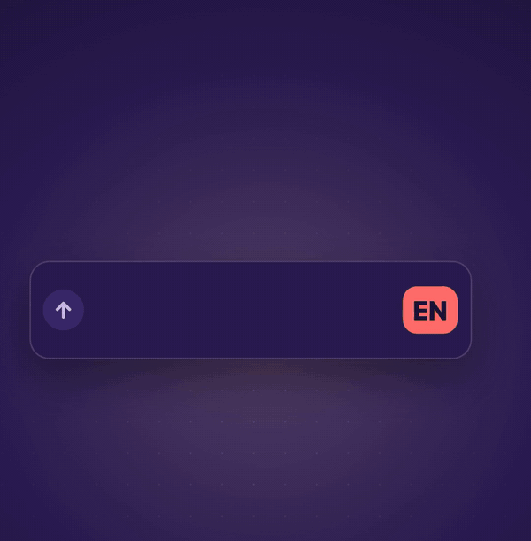

  

<h1 align="center">unfd</h1>

<b>Stop pressing the language key. Your Mac types in the right language, Arabic or English.</b>

**unfd** is «عربي» typed with the English keyboard by mistake, the exact problem this app solves. It lives in the menu bar and switches between Arabic and English for you, and fixes text you already typed in the wrong layout.

## Main features

- **Fix wrong-layout text with `⌥⇧Space`:** typed `hgsghl ugd;l` while the keyboard was on English? Press `⌥⇧Space` and it becomes «السلام عليكم» (works both ways, on the last word or the selected text). The keyboard stays in that language for the field.
- **Address bars and links in English:** browser address bars, email, website and password fields switch to English the moment you click them. No more «غخع» when you meant `you`.
- **Slash commands in English:** a `/` at the start of a word (Claude and other AI apps, Slack, terminals) switches to English; Space, Return, Tab or Escape brings back the language you had before the `/`. A date like 10/2026 does not trigger it.

## Extra features (each one has its own switch in the panel)

- **Spotlight and System Settings follow your Mac's language.**
- **Every other field starts in your Mac's language,** and a field you already wrote in keeps the language of its text.
- **Learns from your corrections:** correct the language 3 times in a row in the same kind of field, and it starts there in that language by itself.
- **Memory per WhatsApp chat:** switch once by hand in a chat and it keeps that language for it.
- **Numbers always 1234:** when it picks Arabic, it uses Apple's "Arabic – 123" layout (the same letters, with 1234567890 on the number row).
- **Fix words as you type (off by default):** when a word you just finished was typed in the wrong layout (`hgsghl` for «السلام»), it is replaced the moment you press Space and the keyboard switches. `⌘Z` within 5 seconds puts the original back and that word is left alone for the rest of the session. Decided with bundled Arabic and English word lists, on your Mac; never in password, link or terminal fields.
- **Start at login.**

## How it works

- It runs in the menu bar only, with no windows. The menu bar shows **ع** or **EN**.
- It needs one permission, **Accessibility**, to know what kind of field you are in (an address bar, a search field, a chat).
- Everything stays on your Mac. The app makes no network connections and never saves what you type. It keeps only settings, the language per WhatsApp chat, and the learned field kinds (app, field type, language).

## Who it is for

Anyone who types both Arabic and English on a Mac and is tired of the language key.

## Requirements

- macOS 14 or later, Apple silicon or Intel.
- An Arabic keyboard layout and an English one (ABC or U.S.) in System Settings > Keyboard > Input Sources.

## Install

1. Download `unfd-0.4.1.zip` from the [latest release](https://github.com/alpha2xyz/unfd/releases/latest) and open it.
2. Move `unfd.app` to the Applications folder.
3. Open it. The app is not notarized by Apple, so macOS blocks the first launch. You do this once:
   - macOS 15 or later: click **Done**, then go to System Settings > Privacy & Security, scroll down and click **Open Anyway** next to the unfd message, then confirm.
   - macOS 14: right-click the app, choose **Open**, then **Open** again.
4. Click the **ع / EN** item in the menu bar and press the button that opens System Settings. Turn on unfd under Privacy & Security > Accessibility.

Prefer Terminal? After step 2, `xattr -dr com.apple.quarantine /Applications/unfd.app` skips step 3.

## Known issues

- The app is signed ad hoc, so after installing a new build, remove unfd from the Accessibility list with «−» and add it again.
- Apps that hide their text from Accessibility fall back to your Mac's language and what the app learned.
- Slash commands do not work where macOS hides key presses from other apps: password fields, and Terminal with Secure Keyboard Entry on.
- On a full menu bar, macOS can hide the ع / EN item behind its « overflow.

## Build from source

Requirements: Xcode 26 or later, [XcodeGen](https://github.com/yonaskolb/XcodeGen). No outside packages.

1. `xcodegen generate`
2. `xcodebuild -scheme unfd -configuration Release -derivedDataPath build build`
3. The app is at `build/Build/Products/Release/unfd.app`.

## License

[MIT](LICENSE)

## Credits

- The Arabic and English word lists in `unfd/Resources/Words/` come from [FrequencyWords](https://github.com/hermitdave/FrequencyWords) by Hermit Dave (OpenSubtitles 2018), licensed [CC BY-SA 4.0](https://creativecommons.org/licenses/by-sa/4.0/). See [NOTICE](NOTICE).
