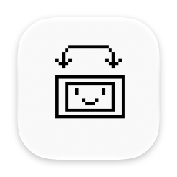
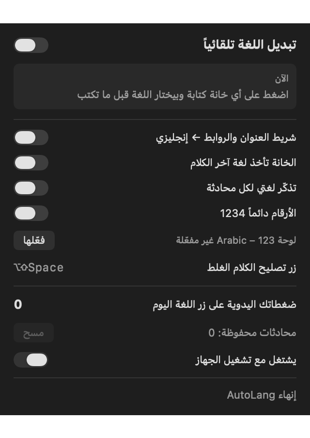

  

<h1 align="center">AutoLang</h1>

<b>Your Mac picks the right keyboard language before you type.</b>

AutoLang lives in the menu bar and switches between Arabic and English for you: English in the browser address bar and in email fields, and the language of the conversation in WhatsApp, Claude, and other apps.

## Install

There is no download yet. Build it from source (below), then:

1. Copy `AutoLang.app` to the Applications folder.
2. Open it. The app is not notarized, so the first time: right-click the app, choose **Open**, then **Open** again.
3. Click the **ع / EN** item in the menu bar and press the button that opens System Settings. Turn on AutoLang under Privacy & Security > Accessibility.

## Requirements

- macOS 14 or later, Apple silicon or Intel. macOS 14 is the minimum because the panel uses SwiftUI's Observation.
- An Arabic keyboard layout and an English one (ABC or U.S.) in System Settings > Keyboard > Input Sources.

## Features

- **Address bars and links in English:** Safari and Chrome address bars, email, website and password fields.
- **The text decides:** clicking into a field reads the last messages or the text near the cursor and picks Arabic or English. It switches only when you move to a new field, never in the middle of a word.
- **Memory per chat:** switch by hand once in a chat and AutoLang keeps that language for it.
- **Numbers always 1234:** when it picks Arabic, it uses Apple's "Arabic – 123" layout, the same letters with 1234567890 on the number row.
- **Fix button `⌥⇧Space`:** turns the last word or the selected text typed in the wrong layout into the right one (`hgsghl` → السلام, `١٢٣` → 123).
- **Manual press counter:** shows how many times today you still pressed the language key.

## How to use

1. Leave it running; turn on start at login in the panel.
2. Click into any text field and type. The menu bar shows the language it chose.
3. Wrong guess in a chat? Switch once by hand; that chat remembers it.
4. Typed in the wrong layout? Press `⌥⇧Space`.

## Privacy

AutoLang reads the focused field and a few nearby messages on your Mac, only to choose a language. Nothing is saved except the chat name and its language (for the memory), and nothing leaves your Mac. The app makes no network connections.

## Known issues

- The app is signed ad hoc, so macOS may ask for the Accessibility permission again after each new build.
- Apps that hide their text from Accessibility fall back to the per-chat memory.

## Build from source

Requirements: Xcode 26 or later, [XcodeGen](https://github.com/yonaskolb/XcodeGen).

1. `xcodegen generate`
2. `xcodebuild -scheme AutoLang -configuration Release -derivedDataPath build build`
3. The app is at `build/Build/Products/Release/AutoLang.app`.

No outside packages.
